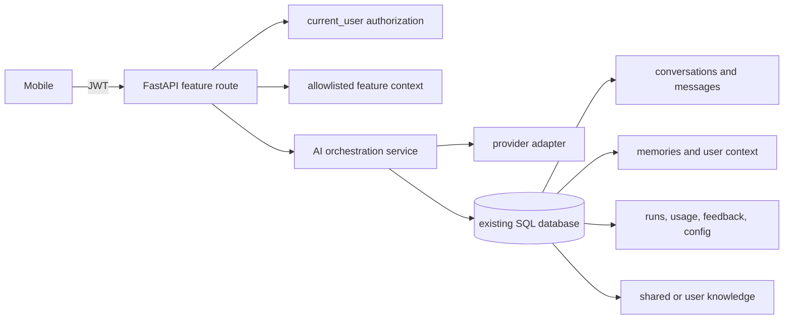

# Mirabi shared AI platform (phase 1)

## Existing system and architecture

The app is Expo/React Native with TypeScript. The backend is FastAPI with synchronous SQLAlchemy sessions and SQLite by default (`DATABASE_URL` can point elsewhere). Authentication is the existing JWT `current_user` dependency. Schema creation and additive upgrades run in `backend/app/migrations.py`; there is no Alembic history yet. Pet, study, quest/task, progression and walk data remain owned by their existing modules. `POST /api/ai/reflection` was the only AI integration and previously called OpenAI directly.

The inference process lives in the separate `ai_engine/` package and runs on port 8002 locally. `backend/app/ai_client.py` forwards authenticated, feature-scoped requests through a service token. The AI Engine owns provider execution, prompt rendering/input-output validation, bounded retry and model credentials. It accesses the existing database's AI tables for config and run/usage persistence; backend alone applies migrations. Context allowlists are enforced in `backend/app/ai_context.py` before requests leave the business API. Source-controlled tools call only registered Python handlers; no database-defined code is executed. The current adapter supports OpenAI Responses API. If the AI process is down, feature routes return a normalized unavailable response; business operations continue.

Feature routes and context providers live in `backend/app/ai_features/`. `reflection.py` is the original feature; `task_planner.py` is the runnable sample. The task planner proposes up to three steps and has no task/EXP/Pet write path. Add a feature module, seed its agent/default prompt, build a minimal allowlisted context in a backend route, then call `call_ai_engine`.

## Tables and ownership

| Table | Purpose | Ownership/access |
|---|---|---|
| `ai_conversations` | Feature scoped conversation/session metadata | One user; every read/write must include `user_id` |
| `ai_messages` | User/assistant message content | Owned through conversation; authorize parent conversation first |
| `ai_memories` | Explicitly controlled long term memories | One user; list/create/delete are owner scoped |
| `ai_user_context` | Structured per-user context key/value | One user; backend service only in this phase |
| `ai_knowledge_documents` | Knowledge source metadata and content | `owner_user_id` set for private; NULL for system shared content |
| `ai_runs` | Per-operation state, model and prompt version, safe error code | One user; admin telemetry hides message content |
| `ai_usage_logs` | Provider/model/token/latency/outcome metrics | Linked to run; operational/admin access only |
| `ai_feedback` | User rating/comment for an AI run | One user; authorize run ownership |
| `ai_feature_configs` | Provider/model and prompt version per feature | System-wide; backend/admin only; no public write route |
| `ai_agents` | Registered feature/module and enabled state | System-wide; changes through admin API and audit |
| `ai_models` | Allowlisted provider/model catalog and optional per-1k-token rates | System-wide; admin only; credentials are never stored here |
| `ai_prompt_versions` | Draft/published/archived prompt source with immutable version numbers | System-wide; admin only; each run records selected version |
| `ai_evaluations` | Admin quality rating attached to a run | Admin only |
| `ai_audit_logs` | Actor/action/target and non-secret change metadata | Admin only; prompt contents and credentials are excluded |
| `ai_embeddings` | Not created | Add only with a concrete semantic search use case and selected vector store |

ERD: `users 1—N ai_conversations 1—N ai_messages`; `users 1—N ai_memories`, `ai_user_context`, `ai_runs`, `ai_feedback`; `ai_runs 1—0..1 ai_usage_logs`; `ai_runs 1—N ai_evaluations`; `ai_runs N—0..1 ai_conversations`; `ai_knowledge_documents` has an optional user owner. `ai_agents 1—1 ai_feature_configs`; `ai_prompt_versions N—1 ai_agents` by feature key. User foreign keys use cascade intent; conversation deletion cascades messages and nulls a retained run's conversation reference.

SQLite currently runs without a defined database-role/RLS model. User-level protection is enforced in backend queries through the authenticated user ID; never expose these tables to clients directly. If moved to Supabase, add RLS policies for every user-owned table and test them with distinct user JWTs before enabling direct client access. Shared documents/config and operational usage belong to a trusted backend/admin role.

Admin authorization uses persisted `users.role`, checked on every request by `admin_user`; it is not trusted from a JWT claim or client state. Set `AI_ADMIN_EMAILS=admin@example.com,operator@example.com` in the backend environment. The admin surface is `/api/admin/ai/*` and the role-gated Expo **More → AI Admin** screen. Configure `AI_SERVICE_URL` and `BACKEND_AI_SERVICE_TOKEN` on backend; configure the matching `AI_SERVICE_TOKEN` and provider key on AI Engine. See `ai_engine/README.md` for local commands. Keep port 8002 private.

For an already existing account, deploy `AI_ADMIN_EMAILS` and restart the API; startup synchronizes the role. If that account already has a live session, sign out and sign back in to refresh the returned user role for the mobile navigation. Authorization itself is checked from the DB on every request.

## API contract

- `POST /api/ai/reflection` (Bearer): `{ "text": "...", "mood": "..." }` -> `{ "reply": "...", "provider": "...", "run_id": 123 }`. The content is stored in a private conversation. Provider errors return 502; missing/disabled configuration returns 503.
- `GET /api/ai/memories` (Bearer): lists only the caller's memories.
- `POST /api/ai/memories` (Bearer): `{ "content": "...", "category": "general" }` -> created memory.
- `DELETE /api/ai/memories/{id}` (Bearer): deletes only caller-owned memory; absent/foreign IDs return the same 204 response.
- `POST /api/ai/task-planner` (Bearer): `{ "request": "..." }` -> text suggestions and run ID; this module does not mutate tasks or progression.
- Admin only: `GET /api/admin/ai/overview`, `GET /models`, `POST /models`, `PATCH /agents/{feature}`, `PUT /features/{feature}/config`, prompt list/create/test/publish routes, `GET /runs`, `POST /runs/{id}/evaluation`, `GET /evaluations`, and `GET /audit`.

Feature service contract: `run_text_feature(db, user_id, feature_key, user_input, system_prompt, conversation=None)` returns text, run ID, provider and model. A feature should construct an allowlisted minimal context before calling it. It must never pass arbitrary ORM/database access to the model. Mutations such as task completion, EXP, Pet progression or rewards must continue through the owning business service and its authorization/validation.

Prompt lifecycle: admins save new immutable draft versions, test a draft through the same provider/service, then publish it. Publishing archives the prior published version. Publishing an archived version restores it and archives the current one. Each change is recorded in `ai_audit_logs`; each test is an AI run and usage record. Model IDs must be registered before a feature can select them. Per-1k-token input/output rates are optional; when present, usage records store estimated micro-USD cost. Cost is reported as unknown if the model rates are unset. Provider secret keys remain environment-only.

## Operations, retention and rollback

New tables are created additively by existing `upgrade_schema()` during API startup; existing business tables/data are untouched. Back up the SQLite file (or database snapshot) before deployment. The migration is idempotent. To roll back this phase, stop the API and invoke `downgrade_ai_schema(engine)` from `backend/app/migrations.py` in a controlled one-off backend command; it drops only AI tables and permanently deletes AI data. Restore a pre-migration backup if that data must be recovered. Do not call rollback while serving traffic. For production PostgreSQL, introduce Alembic before non-additive changes.

Retention is not yet automated: establish a product retention period before production rollout. Users can remove individual memories through the API. Conversation export/deletion and account-erasure orchestration remain follow-up work; message content is not copied into operational logs. Usage rows intentionally contain provider/model, token counts, latency, outcome and run ID only. Avoid storing secrets or credentials in prompts/context. Configure `AI_TIMEOUT_SECONDS`, bounded `AI_MAX_RETRIES` (the engine clamps retries to 3), `AI_MAX_OUTPUT_TOKENS`, `AI_ADMIN_EMAILS` and `OPENAI_MODEL` in service environment/secret management. `OPENAI_API_KEY` belongs only in AI Engine secrets; no AI key belongs in backend or `mobile/.env`.

## Verification

From `backend/`, run `python -m pytest -q`; from `mobile/`, run `npm run typecheck` and `npm test`. Coverage includes two-user memory isolation, admin RBAC, prompt publish/rollback, provider errors, source-registered tool enforcement, migration upgrade/rollback, and the sample planner's no-business-mutation behavior. Configure a backend provider key to run a live-provider smoke test. A provider/model switch is made through the admin feature config after registering that model; no feature-specific mobile change is required. Back up before migration or prompt rollout.
