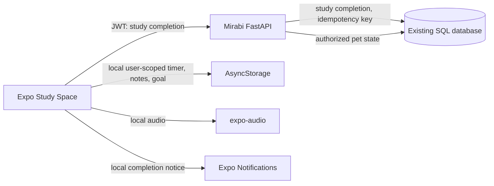

# Mirabi Study Space

## Architecture

The Study Space reuses the existing Expo app, FastAPI authentication and SQL database. It creates no separate database.

## Pomodoro state and data

Timer preferences and the active deadline are stored on the device in AsyncStorage under a key scoped to the authenticated user ID. A wall-clock deadline is persisted, so the display is recalculated after tab changes, app suspension, reload, or relaunch. The OS receives one scheduled local notification for the current phase when permission is granted. Web builds use the same timestamp recovery; browser notifications depend on browser support and permission.

Completed focus cycles are posted to `POST /api/study/pomodoro/{completion_key}?duration_seconds=1500`. `completion_key` is an opaque, per-cycle alphanumeric idempotency key. The backend associates it with the authenticated user, records it in the existing `study_sessions` table, and applies the current study XP daily cap exactly once. A unique `(user_id, pomodoro_cycle)` index prevents duplicate recording. The endpoint does not accept Pet/EXP values and cannot change Pet evolution directly.

`study_sessions.pomodoro_cycle` is nullable so existing records and the legacy session API remain compatible. The migration is additive and idempotent; the current project migration runner supports forward upgrades but does not provide a general SQL downgrade engine. Rollback by reverting the application release; retain the nullable column/index during rollback so completed study data remains intact. Back up the existing database before production schema upgrades using the deployment's normal database snapshot process.

## Study API contract

| Method | Route | Purpose |
| --- | --- | --- |
| `POST` | `/api/study/pomodoro/{completion_key}?duration_seconds={seconds}` | Idempotently record a completed focus cycle under the caller's account and existing study reward rules. |

The endpoint requires a Mirabi access token.

## Audio and speech

`mobile/assets/audio/*.wav` are bundled, original procedurally generated 12-second ambience loops. They have no third-party recording or external network dependency. The rain, forest, stream, cafe, lo-fi and white-noise labels describe synthesized textures, not field recordings. `expo-audio` loops the selected local asset and applies a device volume control. `expo-speech` reads text the learner types or their notes using the device's Vietnamese TTS voice where available. Background audio behavior follows iOS/Android OS settings and user permissions.

After changing Expo native modules, rebuild a custom native client as required by the deployment workflow. Expo Go includes the SDK-compatible modules for local preview.

## Operations

- Run the existing FastAPI migration/startup path before serving the updated app. Schema changes are additive.
- Deploy the backend using its existing release process. Roll back application artifacts through the normal release process; the additive nullable database column is backward compatible.

## Verification

From `mobile/`, run `npm run typecheck` and `npm test`.

From `backend/`, set `PYTHONPATH=..` and run `python -m pytest`. `tests/test_study_pomodoro.py` covers idempotency, per-user isolation and invalid completion keys.
